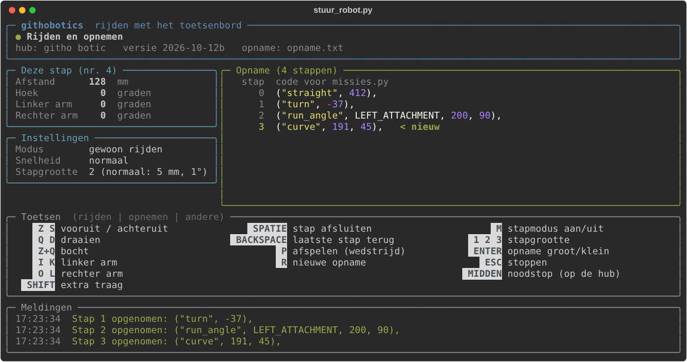

# 4. Uitleg van de code

Hier staat per bestand wat het doet. Wil je een missie schrijven? Dan heb je vooral [3. Missies schrijven](3-missies-schrijven.md) nodig.

**Inhoud**
- [supportcode.py: de gereedschapskist](#supportcodepy-de-gereedschapskist)
- [main.py: het wedstrijdprogramma](#mainpy-het-wedstrijdprogramma)
- [vrij_rijden.py en stuur_robot.py: rijden met het toetsenbord](#vrij_rijdenpy-en-stuur_robotpy-rijden-met-het-toetsenbord)
- [Wat is PID?](#wat-is-pid)

## supportcode.py: de gereedschapskist

Dit bestand voer je nooit zelf uit. Andere bestanden halen er hun onderdelen uit met `import`.

**1. Robot setup.** Hier staat hoe de robot gebouwd is:

| Naam | Poort | Wat |
|---|---|---|
| `LEFT_MOTOR` | C | linker wiel |
| `RIGHT_MOTOR` | D | rechter wiel |
| `LEFT_ATTACHMENT` | E | linker motor voor een opzetstuk |
| `RIGHT_ATTACHMENT` | F | rechter motor voor een opzetstuk |

- `WHEEL_DIAMETER = 62.4`: de diameter van een wiel in mm. Klopt dit niet, dan rijdt de robot te ver of niet ver genoeg.
- `AXLE_TRACK = 153`: de afstand tussen de twee wielen in mm. Klopt dit niet, dan draait de robot te veel of te weinig.
- `DRIVE_BASE`: combineert de twee wielmotoren tot één "rijdend onderstel". Daarmee kan je zeggen "rij 300 mm" in plaats van elke motor apart te sturen.

**2. Veiligheidsfuncties.** `safe_straight`, `safe_turn`, `safe_curve`, `safe_wait` en `safe_run_angle` doen hetzelfde als de gewone Pybricks-functies, maar kijken elke 10 milliseconden of je op de middelste knop drukt. Zo ja, dan roept `check_stop()` een `MissionStop` op: alle motoren stoppen, het lampje wordt rood en de hub piept.

**3. Menu.** `next_program` en `prior_program` gaan één stap vooruit of achteruit in de lijst van missies. Het teken `%` zorgt dat je na de laatste letter terug bij de eerste uitkomt. `wacht_tot_losgelaten()` wacht tot je alle knoppen van de hub loslaat. Zonder die functie denkt het programma dat je opnieuw drukt zolang je de knop vasthoudt.

**4. Snelheidsprofielen.**
- `set_precieze_modus()`: rustig rijden, gyro aan. Dit is de normale modus.
- `set_snelle_modus()`: zo snel mogelijk, gyro uit. Enkel om op het einde terug naar de basis te rijden.
- `start_missie()`: zet afstand en richting op 0 op de plek waar de robot nu staat. Dit gebeurt automatisch bij elke missie.

**5. Stappen-systeem.** `voer_stappen_uit(stappen)` loopt door de lijst van stappen uit `missies.py` en voert ze één voor één uit. Het nummer van de stap verschijnt op het scherm. Met `start_bij` en `eind_stap` kan je maar een stukje uitvoeren (dat gebruikt de testmodus).

**5b. Missies controleren.** `controleer_stappen(stappen)` kijkt een missie na op tikfouten, nog voor de robot rijdt: bestaat de soort stap, staan er genoeg getallen, is een motor echt een motor, ... `main.py` doet dit bij het opstarten voor alle missies. In `STAP_SOORTEN` staat welke soorten stappen er zijn en hoeveel waarden erbij horen. Maak je een nieuwe soort stap in `voer_stappen_uit`, zet ze dan ook in `STAP_SOORTEN`.

**6. `safe_gyro_sprint`.** Een speciale functie om met volle kracht rechtdoor te rijden, met een eigen PID-regeling (zie [Wat is PID?](#wat-is-pid) onderaan). Voor gewone missies gebruik je gewoon `("straight", ...)`.

## main.py: het wedstrijdprogramma

Dit programma toont een letter op het scherm van de hub. De knoppen:

| Knop | Wat gebeurt er? | Kleur lampje |
|---|---|---|
| LINKS / RECHTS | vorige / volgende missie | blauw (**rood** als die missie een fout bevat) |
| MIDDEN | missie starten (pas als je loslaat) | oranje tijdens het rijden |
| MIDDEN tijdens het rijden | noodstop (laat de knop daarna los) | rood |
| LINKS + RECHTS samen | testmodus | |
| MIDDEN bij de letter **V** | rijden met het toetsenbord (zie [hieronder](#vrij_rijdenpy-en-stuur_robotpy-rijden-met-het-toetsenbord)) | wit |

Bij het opstarten worden eerst alle missies gecontroleerd op tikfouten (zie [Missies schrijven](3-missies-schrijven.md#tikfout-in-een-missie)).

Na een geslaagde missie springt het menu vanzelf naar de volgende letter. Na de laatste missie gaat het terug naar A, niet naar V.

**De testmodus** is er om niet telkens een hele missie te moeten rijden als je maar één stap wil controleren.

1. Lampje **geel**: kies met LINKS/RECHTS het nummer van de **startstap**, bevestig met MIDDEN.
2. Lampje **paars**: kies **hoeveel stappen** je wil testen, bevestig met MIDDEN.
3. De robot rijdt dat stukje (lampje oranje), daarna wordt het lampje **groen**:
   - MIDDEN kort: hetzelfde stukje nog eens
   - LINKS + RECHTS: een ander stukje kiezen
   - RECHTS alleen: **verder met het toetsenbord** vanaf de plek waar de robot nu staat (zie [Verder vanaf een missie](#verder-vanaf-een-missie))
   - MIDDEN 1,5 seconde ingedrukt: testmodus verlaten

**Eén stap bijstellen:** kies je precies 1 stap en is dat een `straight` of `turn`, dan wordt het lampje **lichtblauw**. Met LINKS/RECHTS verander je de waarde telkens met 5, met MIDDEN probeer je het meteen. Dit verandert de code zelf **niet**: schrijf het getal op en pas het daarna aan in `missies.py`.

Zet de robot voor elke test met de hand terug op de juiste plek: de robot weet niet waar hij op de mat staat.

## vrij_rijden.py en stuur_robot.py: rijden met het toetsenbord

Hiermee rijd je de robot met het toetsenbord over de mat, en **neemt de robot alles op**. Elke beweging wordt een stap voor `missies.py`. Op de computer staan alle stappen in het bestand `opname.txt`, klaar om te plakken.

**Eenmalig klaarzetten op een Windows-computer:**
1. Download **[stuur_robot.exe](https://github.com/bert1/FLL-githobotics/releases/download/nieuwste/stuur_robot.exe)**. Daarin zitten Python en alle onderdelen al. Je hoeft dus **niets te installeren**.
2. Zet het in een eigen map, bijvoorbeeld `Documenten/robot`. Daar komen later ook `opname.txt` en `alle_opnames.txt`.
3. Dubbelklik op `stuur_robot.exe`. Er opent een zwart venster: dat is het programma.

De eerste keer kan Windows een blauw venster tonen: *"Windows heeft uw pc beschermd"*. Dat komt omdat het programma niet van een bekend bedrijf komt. Klik op **Meer informatie** en dan op **Toch uitvoeren**. Dat moet maar één keer.

#### Op een Mac of Linux, met Python

Daar werkt de `.exe` niet. Gebruik dan het Python-bestand:
1. Installeer Python van [python.org](https://www.python.org/downloads/).
2. Download **[stuur_robot.py](https://github.com/bert1/FLL-githobotics/releases/download/nieuwste/stuur_robot.py)** en zet het in een eigen map, bijvoorbeeld `Documenten/robot`.
3. Open een terminal en typ:

```
pip install bleak pynput rich
```

(`bleak` maakt de Bluetooth-verbinding, `pynput` leest het toetsenbord, `rich` tekent het overzichtelijke scherm.)

Ga daarna in de terminal naar de map met `stuur_robot.py`, bijvoorbeeld met `cd Documenten/robot`, en start het met `python stuur_robot.py`. Op een Mac moet je de terminal toestemming geven om het toetsenbord te lezen (Systeeminstellingen, Privacy en beveiliging, Toegankelijkheid).

**Werkwijze:**
1. Zet de code op de hub zoals altijd, met `main.py`. Je hoeft **geen** ander programma op de hub te zetten.
2. Koppel Pybricks Code los van de hub (Bluetooth-icoontje).
3. Start op de computer `stuur_robot.exe` (dubbelklikken), of op een Mac `python stuur_robot.py`.
4. Verschijnt "Verbonden!"? Druk dan op de knop op de hub zelf om `main.py` te starten.
5. Kies in het menu de letter **V** (lampje wit) en druk op MIDDEN.
6. Rij! Stoppen doe je met ESC op de computer of MIDDEN op de hub. Daarna sta je terug in het menu, klaar voor de wedstrijd.
7. Op de computer blijft de opname nog op het scherm staan. Druk op ENTER om het venster te sluiten.

Je kan ook nog altijd `vrij_rijden.py` zelf op de hub laden en starten, zoals vroeger.

**Toetsen** (AZERTY):

| Toets | Actie |
|---|---|
| Z / S | vooruit / achteruit |
| Q / D | draaien links / rechts |
| Z (of S) samen met Q (of D) | een bocht rijden |
| I / K | linker attachment + / - |
| O / L | rechter attachment + / - |
| SHIFT ingedrukt | extra traag, voor de laatste millimeters |
| M | stapmodus aan/uit: elke tik is één kleine, exacte beweging |
| 1 / 2 / 3 | stapgrootte in de stapmodus: fijn (1 mm) / normaal (5 mm) / grof (20 mm) |
| SPATIE | de huidige stap nu afsluiten |
| ENTER | de opname groot tonen, over het hele scherm (nog eens ENTER: terug) |
| C | de stappen **kopiëren**: plak ze daarna met CTRL+V in `missies.py` |
| BACKSPACE | de laatste stap wissen: de robot rijdt terug naar waar hij voor die stap stond |
| R | de opname wissen en opnieuw beginnen op de plek waar de robot nu staat |
| P | alles **afspelen** op wedstrijdsnelheid (zet de robot eerst terug op de startplek) |
| ESC | stoppen |
| MIDDEN op de hub | stopt altijd meteen |

Voor de cijfers 1, 2, 3 mag je de toetsen bovenaan gebruiken (zonder SHIFT) of het numeriek klavier.

**Zo werkt de opname.** De robot onthoudt welke *soort* beweging je maakt: rechtdoor, draaien, een bocht, de linker of de rechter attachment. Begin je aan een **andere soort**, dan stopt de robot heel even en wordt de vorige beweging een stap. Een voorbeeld:

1. Z ingedrukt houden: de robot rijdt vooruit. Even te ver? Tik S om wat terug te rijden. Dat blijft dezelfde stap.
2. Q indrukken: de robot stopt even, en op de computer verschijnt `Stap 0:  ("straight", 412),`. Nu draait de robot.
3. I indrukken: `Stap 1:  ("turn", -37),` verschijnt, en de arm beweegt.
4. ESC: de laatste stap `("run_angle", LEFT_ATTACHMENT, 200, 90),` komt erbij en `opname.txt` is klaar.

De **toetsen** bepalen welke soort stap het wordt, niet de metingen. Z of S wordt altijd een `"straight"`, ook als de robot onderweg een paar graden afwijkt (geen robot rijdt perfect recht). Q of D wordt altijd een `"turn"`. Die kleine afwijking gaat niet verloren: ze telt mee bij de volgende draai. Week de robot 2 graden af en draai je daarna 90 graden, dan wordt de draai `("turn", 92)`. In de missie houdt de gyro de robot recht, dus zo komt hij toch in de juiste richting uit. Daarom kan "Hoek" in het vak *Deze stap* al een paar graden tonen voor je begint te draaien.

Wil je twee stukken rechtdoor als **twee aparte** stappen? Druk er SPATIE tussen. Was een stap fout? Druk BACKSPACE: de stap verdwijnt uit de opname en de robot rijdt terug, zodat je opnieuw kan proberen.

Op het scherm van de hub staat het nummer van de stap die je nu aan het opnemen bent.

**Het scherm op de computer.** Zodra je `stuur_robot.py` start, wordt het terminalvenster een overzichtelijk scherm met vaste vakken:



| Vak | Wat zie je? |
|---|---|
| bovenaan | wat er nu gebeurt (het bolletje is **groen** als je kan rijden, **geel** als je iets moet doen, **rood** bij een probleem), de naam van de hub en de versie van de code |
| Deze stap | hoeveel de robot al bewogen is in de stap die nu loopt |
| Instellingen | stapmodus aan of uit, extra traag (SHIFT) en de stapgrootte |
| Opname | alle opgenomen stappen, met hun nummer. De nieuwste is groen. Kwam je uit de testmodus, dan staat onderaan waar je de stappen moet plakken |
| Toetsen | een spiekbriefje met alle toetsen |
| Meldingen | de laatste berichten, met het tijdstip |

Is je venster klein, dan worden de vakken kleiner en verdwijnt het vak Meldingen: de laatste melding staat dan bovenaan. Maak het venster groter (of zet het op volledig scherm) om alles te zien. Na het stoppen komt je gewone terminal terug, met de hele opname erin: enkel de stappen, zonder kader en zonder tijdstip.

**Van opname naar missie.** De makkelijkste manier: druk **C** (tijdens het rijden) en plak de stappen met **CTRL+V** in je missie in `missies.py`, boven `("call", stop_attachments)`. Als je stopt met ESC, staan de stappen zelfs vanzelf al op het klembord. Je hoeft dus niets te selecteren in het zwarte venster.

Liever met een bestand? Open `opname.txt` (in dezelfde map als `stuur_robot.py`). Het ziet er zo uit:

```
# Opname van stuur_robot.py (12-10-2026 14:03)
# Kopieer de stappen naar je missie in missies.py, boven de regel
# ("call", stop_attachments). Het nummer achter # is het stapnummer.
    ("straight", 412),                              # stap 0
    ("turn", -37),                                  # stap 1
    ("run_angle", LEFT_ATTACHMENT, 200, 90),        # stap 2
```

Kopieer de stappen in je missie in `missies.py`, boven `("call", stop_attachments)`. Test daarna met de testmodus. Bij een nieuwe opname wordt `opname.txt` overschreven. Geen nood: elke afgewerkte opname komt ook in **`alle_opnames.txt`**, met de **nieuwste bovenaan**. Elke opname begint daar met een regel als `# ===== Opname van 22-10-2026 14:03 (3 stappen) =====`. Er staat geen tijdstip voor elke stap, en stappen die je met BACKSPACE gewist hebt, staan er niet in. Zo kan je ze zonder knippen kopiëren.

**Afspelen met P.** Met het toetsenbord rijdt de robot traag. In de missie rijdt hij veel sneller, en dan kan hij net iets anders uitkomen (bijvoorbeeld als hij tegen iets aan botst). Daarom kan je alles meteen afspelen zoals in de echte missie:

1. Zet de robot met de hand terug op de startplek.
2. Druk P. De robot rijdt alle opgenomen stappen op wedstrijdsnelheid, met de gyro aan (lampje oranje). MIDDEN op de hub stopt het afspelen.
3. Daarna rijd je gewoon verder met het toetsenbord. Nieuwe stappen komen achteraan bij de opname.

Gaat het niet goed? Rij terug naar de juiste plek, druk BACKSPACE om de foute stap te wissen, en neem hem opnieuw op.

### Verder vanaf een missie

Is het begin van een missie al klaar en wil je enkel het **volgende stuk** opnemen? Dan hoef je de robot niet met de hand op de juiste plek te zetten:

1. Start `stuur_robot.py` op de computer en `main.py` op de hub (zoals hierboven).
2. Kies in het menu de missie, bijvoorbeeld B, en ga naar de testmodus (LINKS + RECHTS).
3. Kies de startstap (meestal 0) en hoeveel stappen de robot moet rijden, bijvoorbeeld 5. De robot rijdt stap 0 tot en met 4.
4. Het lampje wordt groen. Druk **RECHTS** alleen: het lampje wordt wit en je rijdt verder met het toetsenbord.
5. De nieuwe stappen krijgen meteen de juiste nummers (hier vanaf stap 5). Bovenaan `opname.txt` staat waar je ze moet plakken: *"Plak deze stappen in MISSIE_B, net na stap 4."*
6. Met P speel je de missie af vanaf de startstap **plus** de nieuwe stappen. Zet de robot dan eerst terug waar hij stond bij het begin van de test.

Als je stopt (ESC of MIDDEN), kom je terug in het menu.

**Goed om te weten:**
- Heel kleine bewegingen (minder dan 3 mm of 1 graad) worden geen stap. Die tellen mee bij de volgende stap.
- De snelheid in een opgenomen attachment-stap is altijd 200. Pas ze daarna gerust aan in `missies.py`.
- Als je rechtdoor vertrekt, rijdt de robot eerst een kwart seconde heel traag. Zo trekken beide motoren de speling tussen de tandwielen weg, en schommelt de robot niet bij het vertrekken.
- Daarna rijdt hij nog anderhalve seconde zonder gyro: de wielen houden hem recht. Pas dan stuurt de gyro bij, eerst heel zacht. Wijkt de robot toch een beetje af, dan is dat niet erg: die afwijking telt mee in de volgende draai.
- Laat je een toets los, dan remt de robot hard en staat hij meteen stil. Ook de attachments stoppen meteen. De computer stuurt een losgelaten toets ook meteen door, zonder te wachten.
- `rijlog.txt` van een vorige versie wordt niet meer gebruikt. Je mag het weggooien.

**Veiligheid:** komt er 0,5 seconde lang niets binnen van de computer (verbinding weg), dan stopt de robot vanzelf.

**Instellingen** staan bovenaan `vrij_rijden.py`: snelheden, hoe zacht de robot vertrekt (`RIJ_VERSNELLING`, `DRAAI_VERSNELLING`), hoe hard hij afremt (`RIJ_AFREMMEN`, `DRAAI_AFREMMEN`), het rustig vertrekken (`AANLOOP_SNELHEID`, `AANLOOP_TIJD`), hoelang de gyro wacht voor hij bijstuurt (`GYRO_WACHTTIJD`, `GYRO_INLOOPTIJD`), de stapgroottes (`STAPGROOTTES`), de snelheid in opgenomen attachment-stappen (`ATTACHMENT_SNELHEID_IN_MISSIE`), vanaf wanneer een beweging een stap wordt (`MIN_AFSTAND`, `MIN_HOEK`, ...) en de PID-waarden. Met `GEBRUIK_EIGEN_PID = False` gebruik je de ingebouwde gyroregeling van Pybricks in plaats van onze eigen PID. Probeer beide en kies wat het rechtst rijdt.

Heet jullie hub anders dan `githo botic`? Maak dan in dezelfde map als `stuur_robot.exe` (of `stuur_robot.py`) een tekstbestand `hubnaam.txt` (met Kladblok) en typ daarin enkel de naam van jullie hub, precies zoals in Pybricks Code. Met `stuur_robot.py` kan je ook `HUB_NAME` bovenaan het bestand aanpassen.

**Werkt het niet?**
- Zegt de computer *"Deze stuur_robot.py past niet bij de code op de hub"* of *"De hub heeft een oude vrij_rijden.py"*? Download dan de nieuwste `stuur_robot.py` **en** de nieuwste code voor de hub. Ze moeten van dezelfde versie zijn.
- Reageert de robot niet? Kijk of je in het menu wel de letter V gestart hebt.
- Zegt het programma *"Kopiëren lukt niet op deze computer"*? Open dan `opname.txt` en kopieer daar. (Op Linux moet daarvoor `xclip` geïnstalleerd zijn.)
- Verdwijnt `stuur_robot.exe` meteen, of zegt de virusscanner van school dat het gevaarlijk is? Dat gebeurt soms met programma's die zelf gemaakt zijn. Vraag de leerkracht om het toe te laten, of gebruik `stuur_robot.py` met Python.

---

## Wat is PID?

De robot rijdt nooit perfect recht: een wiel slipt een beetje, de mat is niet vlak... De **gyro** in de hub meet in welke richting de robot kijkt. **PID** is een slimme manier om bij te sturen.

Stel: de robot moet naar 0 graden kijken, maar kijkt naar 3 graden. De **fout** is dan 3 graden.

- **P (proportioneel):** hoe groter de fout, hoe harder bijsturen. Te groot: de robot zigzagt. Te klein: hij stuurt te traag bij.
- **I (integraal):** telt kleine fouten op die maar blijven hangen, en werkt die zo toch weg.
- **D (afgeleide):** kijkt hoe snel de fout verandert en remt de bijsturing af, zodat de robot niet doorschiet.

```
correctie = KP * fout + KI * opgetelde_fout + KD * verandering_van_de_fout
```

Instellen doe je door te proberen: begin met enkel P, zet I en D op 0. Verhoog P tot de robot begint te zigzaggen en neem dan iets minder. Voeg daarna een beetje D toe tegen het zigzaggen, en een beetje I als hij steeds net naast de lijn eindigt.

---

---

[Terug naar de startpagina](../README.md)
